# FixLab: Phone Repair Trainer

A free Android app, built with Expo and React Native, that teaches smartphone hardware repair. It has no ads, no login and no analytics.

You only need VS Code and a phone. Android Studio is not required.

## Screenshots

| | | |
|:-:|:-:|:-:|
| 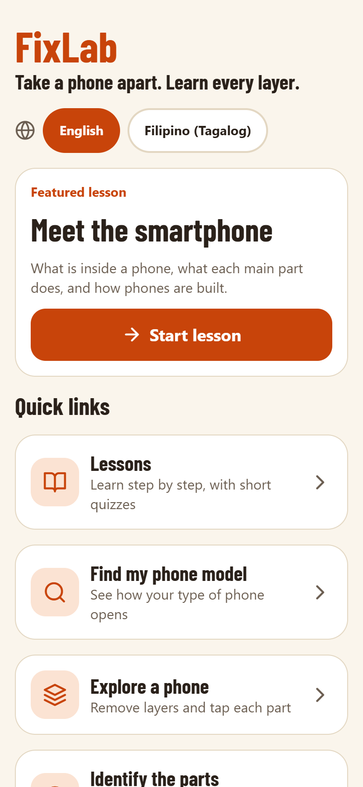<br>Home | 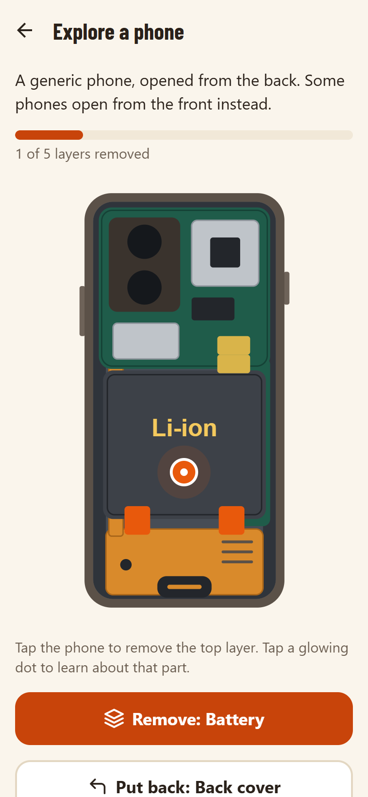<br>Explore a phone | 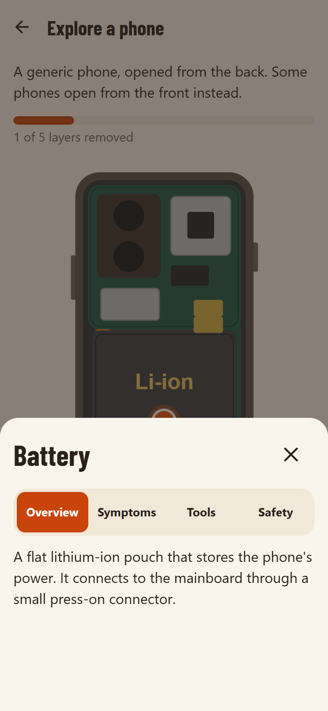<br>Part details |
| 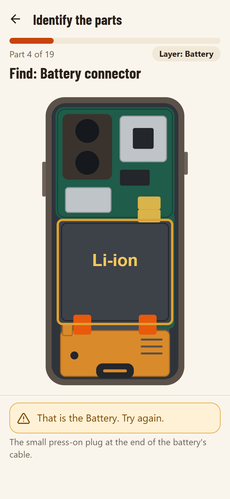<br>Identify the parts | 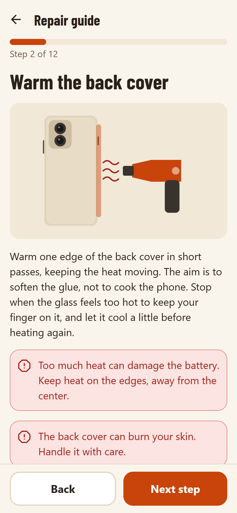<br>Repair guide | 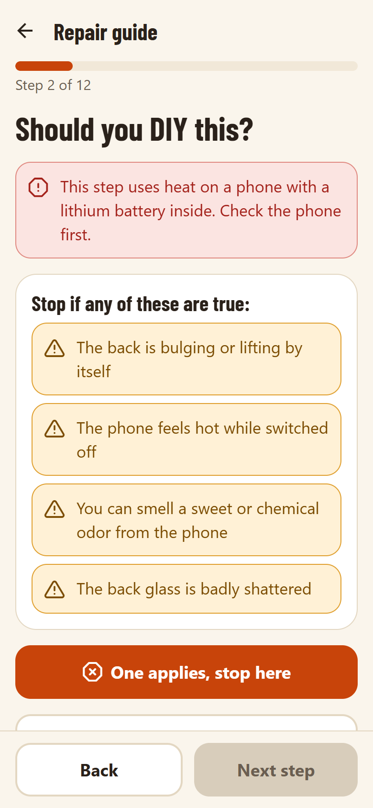<br>Should you DIY this? |
| 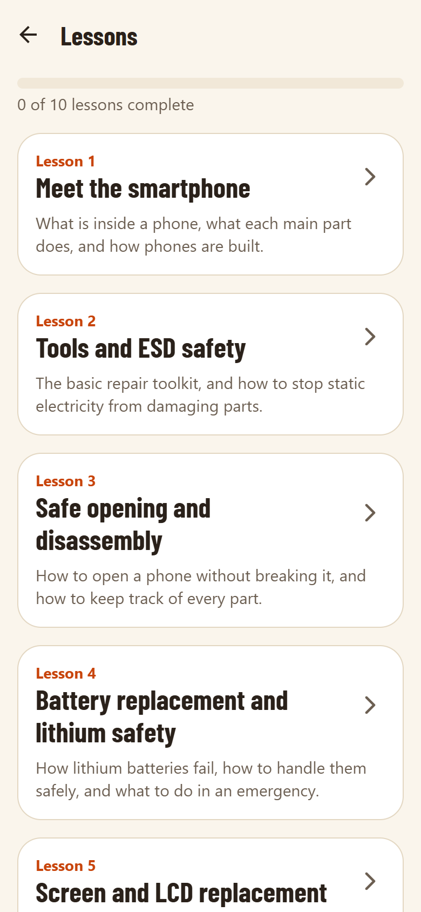<br>Lessons | 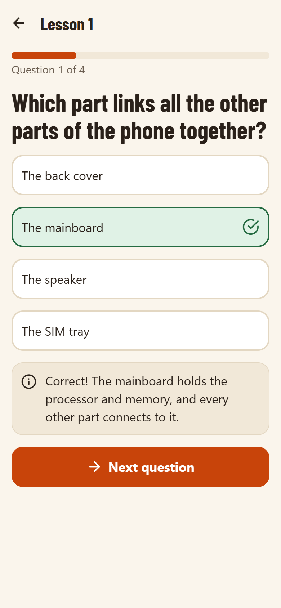<br>Quizzes | 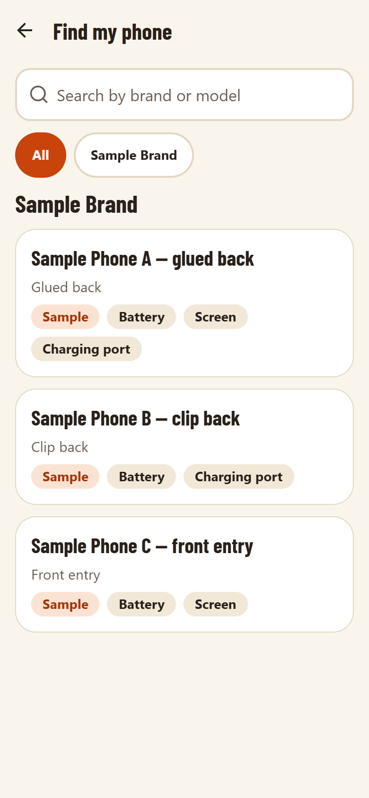<br>Find my phone |
| 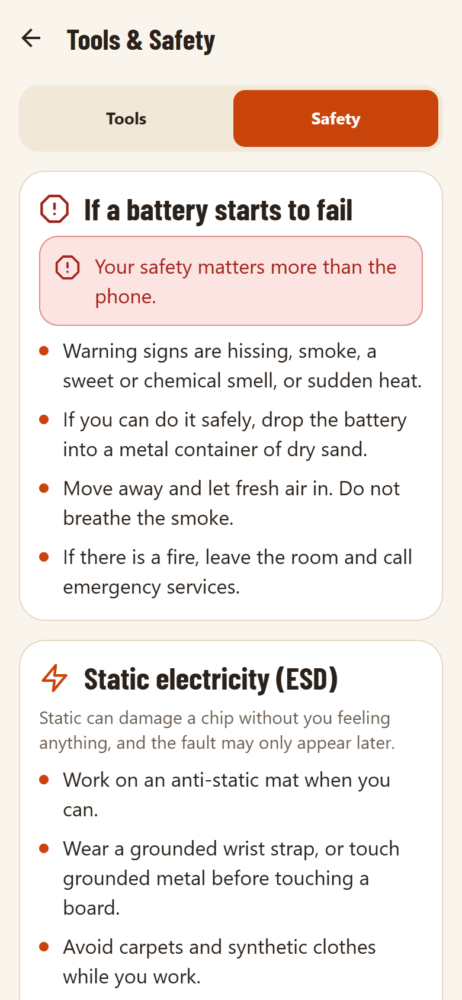<br>Tools & Safety | 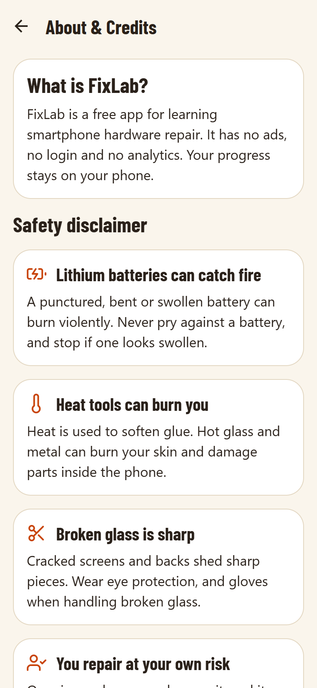<br>About & Credits | 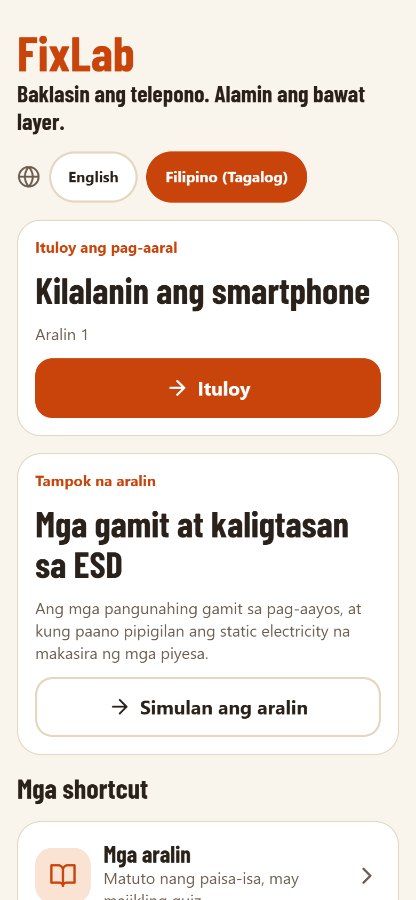<br>Filipino (Tagalog) |

## Run the app on your phone

1. Install **Expo Go** on an Android phone from the Play Store.
2. Install dependencies once: `npm install`
3. Start the dev server: `npx expo start`
4. Scan the QR code with Expo Go. The phone and computer must be on the same Wi-Fi network. If they cannot connect, use `npx expo start --tunnel`.

To see the safety disclaimer again, clear Expo Go's storage in Android settings.

## Checks

Run these after every change:

```
npm run typecheck
npm run lint
```

## Add a new phone model

Add one JSON file to `content/models/`. No code changes are needed, because the app loads every file in that folder.

```json
{
  "id": "my-phone-id",
  "brand": "Brand name",
  "name": "Model name",
  "constructionType": "glued-back",
  "difficulty": "moderate",
  "availableRepairs": ["battery", "screen", "charging-port"],
  "parts": ["back-cover", "battery", "mainboard", "rear-camera", "charging-flex", "display"],
  "externalLinks": [
    {
      "title": "Guide title",
      "url": "https://example.com/guide",
      "source": "Site name",
      "license": "CC BY-NC-SA"
    }
  ],
  "isSample": false
}
```

- `constructionType` must be `glued-back`, `clip-back` or `front-entry`.
- `difficulty` must be `easy`, `moderate` or `hard`.
- `parts` must use ids from `content/parts.json`.
- Only add real models from verified sources. Never guess specifications.
- Do not copy text or images from other guides. Linking with attribution is fine.

A file with a mistake is skipped, and the reason appears as a warning in the `npx expo start` terminal. Restart with `npx expo start --clear` if a new file does not appear.

## Add a repair guide

Add one JSON file to `content/guides/`, following `battery-glued-back.json`. Set either `constructionType` or `modelId`, not both. A guide for an exact model takes priority over one for its construction type.

Add `diyGate` to a risky step to hide it behind the "Should you DIY this?" check.

## Add a lesson

Add one JSON file to `content/lessons/`, following the existing files. `order` sets its place in the track. In each quiz question, `correctIndex` counts from 0. A student passes with 70% or more.

## Languages

The app ships in English and Filipino (Tagalog). It starts in Filipino on phones set to Filipino or Tagalog, and students can switch on the disclaimer and Home screens.

Translations are separate from the English content:

- UI strings: `src/i18n/fil.json`, with the same keys as `en.json`.
- Content: `content/translations/fil/`, with the same folders and file names as `content/`. Each file holds the `id` and only the wording. Lists must keep the same length and order as the English, and quiz options must stay in the same order so the right answer stays right.

Anything without a translation shows in English, so a new phone or guide works before it is translated.

To add another language with code `xx`:

1. Copy `src/i18n/fil.json` to `src/i18n/xx.json` and translate it.
2. In `src/i18n/index.ts`, add it to `dictionaries` and `LOCALES`.
3. Add translated files under `content/translations/xx/`.

## Replace placeholder images

Step images live in `assets/placeholders/`. They are original drawings with no words, so they work in every language. To use a real photo, replace a file with one that has the same name, or add a new file and point the step's `image` field at it. Use a photo you took yourself or have permission to use, with no brand logos showing. A 16:10 landscape photo fits best.

## Build and submit with EAS

Builds run in the cloud, so no local Android SDK is needed.

1. Before your first build, change `android.package` in `app.json` from `com.CHANGE_ME.fixlab` to your own id. It cannot be changed after the app is published.
2. Install the CLI and sign in: `npm install -g eas-cli`, then `eas login`
3. Link the project: `eas init`
4. Build:
   - Test APK to install directly: `eas build -p android --profile preview`
   - Play Store bundle (`.aab`): `eas build -p android --profile production`
5. Submit to Google Play: `eas submit -p android --latest`

The first submission must be uploaded by hand in the Play Console. Google Play requires new apps and updates to target Android 16 (API level 36). Expo SDK 58 targets API 36. Check the requirement again whenever you submit.

## Project layout

```
app/                   Screens (Expo Router)
content/               Bundled JSON content
  models/              One file per phone
  guides/              One file per repair guide
  lessons/             One file per lesson
  translations/        Translated wording, one folder per language
assets/placeholders/   Placeholder step images
src/components/        Shared UI, Explore and guide components
src/content/           Content loader and validation
src/i18n/              All UI strings, one JSON file per language
src/state/             Saved language, disclaimer and progress
src/theme/             Colors, spacing and type
src/types/content.ts   Content types
```
